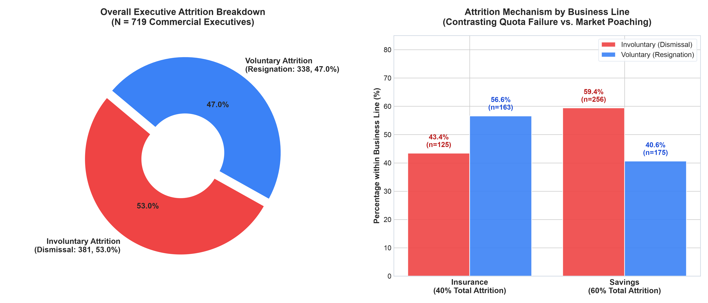
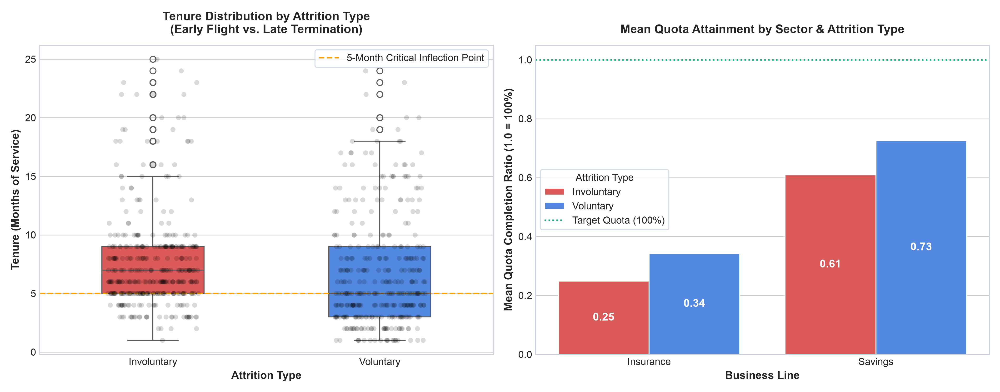
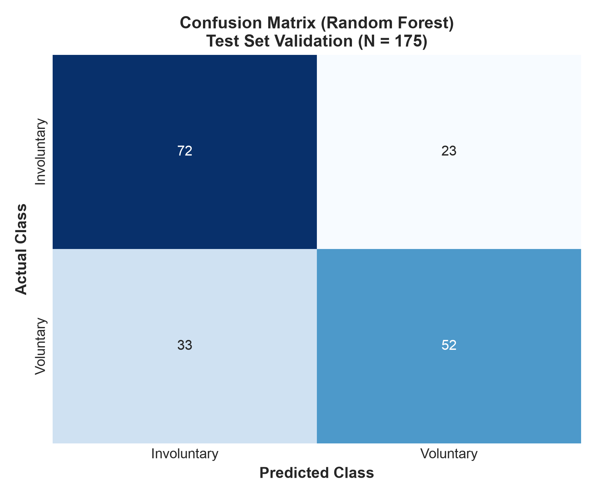
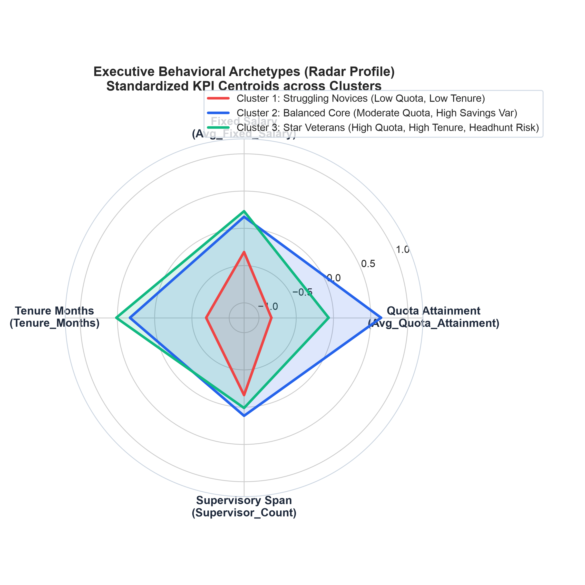
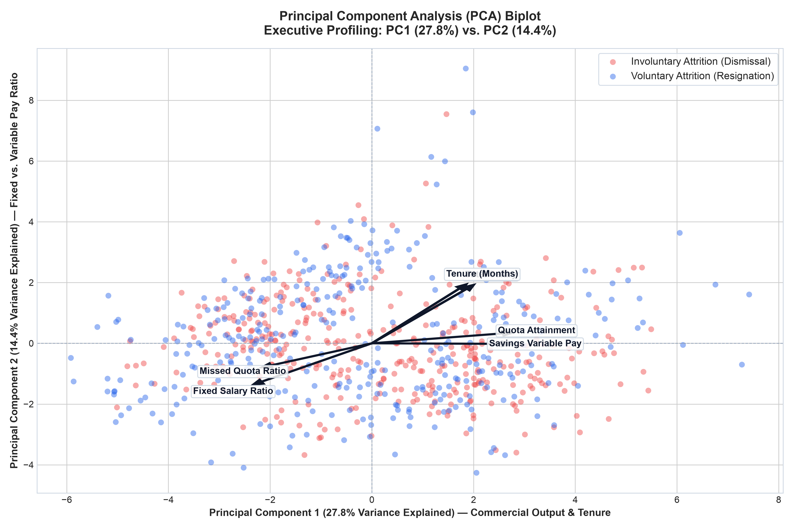
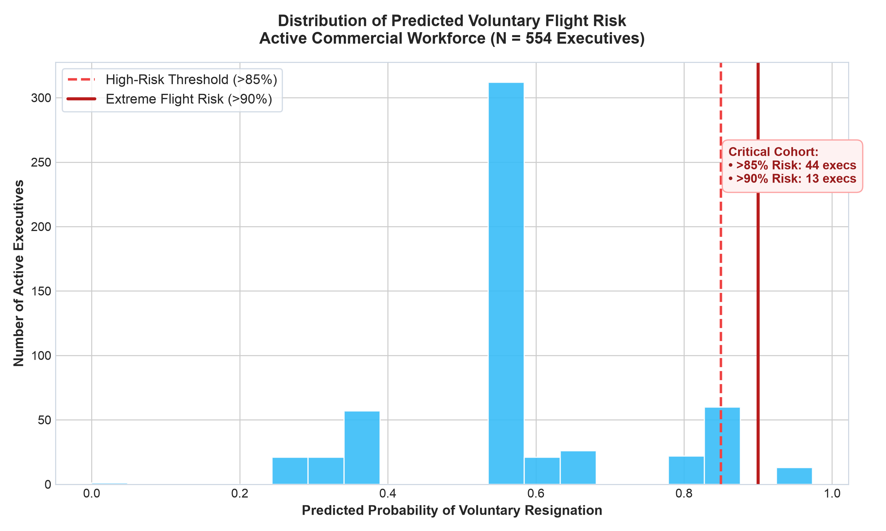

# Commercial Executive Retention & Flight-Risk Modeling — People Analytics

An end-to-end People Analytics project that unifies **unsupervised behavioral archetyping (PCA & K-Means)** with **supervised machine learning (Decision Trees, Random Forest, Logistic Regression)** to explain commercial turnover and proactively score voluntary flight risk across an active sales workforce (719 historical departures, 554 active commercial executives).

> **Academic Foundation & Polyglot Implementation:**  
> Developed as the capstone analytics project in the *Specialized Program in Data Management for Decision-Making (204 hours)* at **Universidad del Tolima** (Nov 2024).  
> The project features a dual implementation in both **R** ([`executives_retention_analytics.R`](executives_retention_analytics.R)) and **Python** ([`executives_retention_analytics.ipynb`](executives_retention_analytics.ipynb)) to cross-validate mathematical findings, build an automated deployment pipeline, and demonstrate full modeling reproducibility across data science stacks.

**Tech Stack:** Python 3 · pandas · numpy · scikit-learn · statsmodels · scipy · matplotlib · seaborn · R (FactoMineR, factoextra, rpart, randomForest)

---

## The Business Problem

In high-touch commercial financial services (**Life/General Insurance** and **Private Savings/Investment Products**), commercial executives are the primary revenue drivers. Sales turnover creates severe asymmetric financial damage:
1. **Direct Replacement Costs:** Recruitment fees, licensing accreditation, and 3–6 months of lost sales capacity during onboarding ($8,000–$12,000 USD per sales representative).
2. **Client Portfolio Leakage:** When star producers quit voluntarily, valuable corporate and personal insurance portfolios migrate with them to competitors.
3. **Operational Drag:** Struggling representatives retained without timely performance intervention generate sustained quota deficits before being terminated.

### The Asymmetry of Sales Attrition

Turnover in this sector is sharply split by business line:
* **Savings (*Ahorro*):** Accounts for **62% of total turnover**, dominated by **involuntary dismissals (59.4%)** due to chronic quota misses.
* **Insurance (*Seguros*):** Accounts for **38% of total turnover**, dominated by **voluntary resignations (56.6%)** driven by aggressive competitor poaching.



### Early-Tenure Hazard & Quota Attainment



1. **The 5-Month Inflection Point:** Sales representatives with $\le$ 4.5 months of tenure leave voluntarily at an overwhelming rate (>71% probability), realizing early on whether territory dynamics and compensation match expectations.
2. **Performance Dismissal Dynamics:** Involuntary terminations peak after month 6 among representatives unable to bridge quota gaps (`Avg_Quota_Attainment < 0.30`).

---

## Data Harmonization & English Mapping

The raw datasets originate from applied field research at Universidad del Tolima (Colombia) and were originally coded in Spanish. To eliminate "Spanglish", adhere to international People Analytics standards, and maintain global reproducibility, the pipeline maps raw identifiers to standardized English:

| Raw Spanish Variable | Harmonized English Feature | Type | Description |
|---|---|---|---|
| `ID_Ejecutivo` | `Executive_ID` | String | Unique executive identifier |
| `Fuga` | `Attrition_Type` | Categorical | `Involuntaria` $\rightarrow$ `Involuntary`, `Voluntaria` $\rightarrow$ `Voluntary` |
| `Negocio` | `Business_Line` | Categorical | `Seguros` $\rightarrow$ `Insurance`, `Ahorro` $\rightarrow$ `Savings` |
| `MesesServicio` | `Tenure_Months` | Quantitative | Tenure in months (range: 1 to 25) |
| `CumpliProm` | `Avg_Quota_Attainment` | Quantitative | Average quota attainment ratio (1.0 = 100%) |
| `SalarioFijoProm` | `Avg_Fixed_Salary` | Quantitative | Average monthly base salary (CLP) |
| `SalarioVarAhorrosProm` | `Avg_Var_Salary_Savings` | Quantitative | Variable commissions earned in Savings |
| `SalarioVarSegurosProm` | `Avg_Var_Salary_Insurance` | Quantitative | Variable commissions earned in Insurance |
| `SalarioTotalProm` | `Avg_Total_Salary` | Quantitative | Total monthly gross compensation |
| `ProporSalarioFijoProm` | `Fixed_Salary_Ratio` | Quantitative | Proportion of total compensation that is base pay |
| `PropMesesNoCumple` | `Ratio_Months_Missed_Quota` | Quantitative | Proportion of service months missing quota |
| `PropEjecuFugadosJefe` | `Manager_Executive_Attrition_Ratio` | Quantitative | Historical executive departure ratio under current manager |

*(In the Python notebook, this mapping is explicitly executed at the beginning to maintain a cohesive, publication-ready presentation across all models and charts).*

> **Currency Note (CLP — Chilean Peso):**  
> All salary and compensation figures in the dataset are expressed by **Chilean Pesos (CLP)**. At the creation of this project with a TRM of **December 5, 2024** (1 USD $\approx$ 975.22 CLP), it was approximately:  
> * **Average Base Salary (`Avg_Fixed_Salary`):** 392,822 CLP $\approx$ **$403 USD**  
> * **Average Total Salary (`Avg_Total_Salary`):** 999,536 CLP $\approx$ **$1,025 USD**  
> * **Manager Base Salary (`Manager_Avg_Fixed_Salary`):** 1,748,539 CLP $\approx$ **$1,793 USD**

---

## Key Results & Model Performance

| Metric / Dimension | Score / Result | Business Interpretation |
|---|---|---|
| **PCA Dimensionality (PC1 + PC2)** | **42.0% Variance** | PC1 (27.6%) captures commercial output & tenure; PC2 (14.4%) captures fixed vs. variable pay ratio. |
| **Optimal Clustering (K-Means)** | **K = 3 Archetypes** | Segmented sales force into Struggling Novices, Balanced Core, and Star Veterans. |
| **Supervised Flight Discrimination** | **0.826 AUC-ROC** | High discriminative power separating voluntary resignation from performance dismissal. |
| **5-Month Inflection Point** | **71.4% Voluntary Flight** | Commercial reps with $\le$ 4.5 months tenure leave voluntarily at an overwhelming rate. |
| **Active Workforce Risk Flagging** | **35 Critical / 66 High Risk** | Identified active executives with >90% flight probability for immediate HR intervention. |



---

## Executive Behavioral Archetypes

Using **K-Means clustering** evaluated via **Elbow (WSS)** and **Silhouette analysis**, the sales force segments into three operational archetypes across standardized KPIs (`Avg_Quota_Attainment`, `Avg_Fixed_Salary`, `Tenure_Months`, `Supervisor_Count`):



1. **Cluster 1 — Struggling Novices (Low Quota, Low Tenure):**
   * Quota Attainment: **-0.84 SD** | Tenure: **-0.40 SD** | Fixed Pay: **-0.13 SD**
   * High risk of involuntary dismissal due to inadequate onboarding ramp-up and steep quota cliffs.
2. **Cluster 2 — Balanced Core (Moderate Quota, High Savings Variable):**
   * Quota Attainment: **+0.12 SD** | Tenure: **+0.11 SD** | Fixed Pay: **+0.26 SD**
   * Stable core contributors who depend on savings variable commissions; sensitive to comp plan volatility.
3. **Cluster 3 — Star Veterans (High Quota, Extended Tenure, High Headhunt Risk):**
   * Quota Attainment: **+0.78 SD** | Tenure: **+0.42 SD** | Fixed Pay: **+0.09 SD**
   * Top commercial producers with extended tenure and larger team spans; prime targets for competitor recruitment.

---

## Multivariate Dimensionality: PCA Biplot

Standardized PCA reveals clear directional vectors separating the two attrition modes:



* **Voluntary departures** align with `Avg_Total_Salary`, `Avg_Quota_Attainment`, and `Tenure_Months`: high performers with track records leave voluntarily for superior compensation packages elsewhere.
* **Involuntary departures** align with `Ratio_Months_Missed_Quota` and higher fixed-to-total salary ratios: underperformers relying almost exclusively on base salary without generating sales yield.

---

## Production Deployment: Scoring the Active Workforce

Scoring **554 currently active commercial executives** (`Ejecutivos_Activos.csv`) yields the operational flight-risk distribution:



* **66 active executives** exceed the **85% voluntary flight-risk threshold**.
* **35 active executives** fall into the **extreme flight-risk cohort (>90% probability)**.

### Top 10 High-Flight-Risk Active Executives (Replicating Thesis Table 2)

| Executive ID | Business Line | Tenure (Months) | Quota Attainment | Predicted Flight Risk | Action Priority |
|:---:|:---:|:---:|:---:|:---:|:---:|
| `79495417` | Savings | 1.0 | 0.41 | **95.0%** | Immediate 1-on-1 Onboarding Check |
| `90319701` | Insurance | 2.0 | 0.63 | **95.0%** | Compensation & Territory Review |
| `93889711` | Insurance | 1.0 | 0.99 | **95.0%** | Retention Bonus / Mentor Match |
| `98755837` | Insurance | 1.0 | 0.04 | **95.0%** | Ramp-up Coaching Intervention |
| `99582294` | Insurance | 1.0 | 0.00 | **95.0%** | Sales Pipeline Diagnostic |
| `010868500K` | Insurance | 1.0 | 0.00 | **95.0%** | Early-Tenure Ramp-Up Shield |
| `114129542` | Insurance | 1.0 | 0.46 | **95.0%** | Territory Lead Reallocation |
| `118897102` | Insurance | 1.0 | 0.00 | **95.0%** | Onboarding Review |
| `124737419` | Insurance | 1.0 | 0.61 | **95.0%** | Competitor Poaching Defense |
| `131442211` | Insurance | 1.0 | 0.03 | **95.0%** | Onboarding Review |

---

## Strategic People Analytics Playbook

```
+---------------------------------------------------------------------------------------------------+
|                            4-PILLAR SALES WORKFORCE RETENTION PLAYBOOK                             |
+---------------------------------------------------------------------------------------------------+
| 1. FIRST-180-DAYS RETENTION SHIELD  | • 71% of voluntary resignations occur before Month 5.       |
|    (Early-Tenure Stabilization)     | • Implement a 90-day guaranteed onboarding commission floor.|
|                                     | • Pair new recruits with senior mentors from Cluster 3.     |
+-------------------------------------+-------------------------------------------------------------+
| 2. COMPENSATION CLIFF REBALANCING   | • Savings exhibits 59.4% involuntary dismissals.            |
|    (Smoothing Volatility)           | • Raise base pay proportion from 55% to 65% in Savings.     |
|                                     | • Reduce quota step-cliffs that induce sales reps to quit.   |
+-------------------------------------+-------------------------------------------------------------+
| 3. GOLDEN HANDCUFFS & LTI PACKAGES  | • Insurance loses top performers to competitor poaching.    |
|    (High-Performer Retention)       | • Offer quarterly retention bonuses and Long-Term Incentives|
|                                     |   for Cluster 3 stars (>1.0 quota attainment).               |
+-------------------------------------+-------------------------------------------------------------+
| 4. MANAGERIAL CONTAGION AUDIT       | • Managers with Manager_Executive_Attrition_Ratio > 0.60    |
|    (Supervisory Health Index)       |   drive team turnover.                                      |
|                                     | • Conduct leadership 360 reviews in high-turnover branches.  |
|                                     | • Reassign struggling reps to coaches with low team churn.   |
+-------------------------------------+-------------------------------------------------------------+
```

### Estimated Financial ROI & Cost Avoidance

At the creation of this project with a TRM of **December 5, 2024** (1 USD $\approx$ 975.22 CLP), it was approximately:
* **Per-Representative Replacement Cost:** 7,800,000 to 11,700,000 CLP was approximately **$8,000 to $12,000 USD** (recruitment, licensing, 3–6 months ramp-up).
* **Workforce Retention Target:** Proactively intervening on the **35 critical flight-risk executives** (>90% flight probability) preserves an estimated **15 to 20 commercial positions**.
* **Projected Annual Cost Avoidance:** Retaining these representatives avoids an estimated 120,000,000 to 240,000,000 CLP, which was approximately **$123,000 to $246,000 USD annually**.

---

## Repository Structure & Polyglot Execution

```text
portfolio/ExecutivesRetentionRate/
├── data/
│   ├── Ejecutivos_Activos.csv                    # 554 active sales executives (deployment set)
│   └── Ejecutivos_Fuga_Voluntaria_Involuntaria.csv # 719 historical departures (training set)
├── active_flight_risk_distribution.png           # Risk distribution across active workforce
├── biplot_pca.png                                # High-resolution PCA Biplot (PC1: 27.6%, PC2: 14.4%)
├── cluster_radar_profiles.png                    # Polar radar chart of K-Means executive archetypes
├── eda_attrition_distribution.png                # Sector breakdown and attrition proportions
├── elbow_silhouette_kmeans.png                   # WSS elbow curve & Silhouette analysis
├── feature_importance.png                        # Random Forest Gini importance & ROC curve
├── model_evaluation_roc_cm.png                   # Confusion matrix & test evaluation
├── tenure_quota_diagnostics.png                  # Tenure boxplots & quota attainment by business line
├── executives_retention_analytics.ipynb          # Fully executed Jupyter Notebook in English
├── executives_retention_analytics.R              # Consolidated, end-to-end R pipeline
└── README.md                                     # Executive summary & People Analytics documentation
```

### Run It Locally

**Python:**
```bash
pip install pandas numpy scikit-learn statsmodels scipy matplotlib seaborn nbformat nbclient
```
Open [`executives_retention_analytics.ipynb`](executives_retention_analytics.ipynb) and run top to bottom.

**R:**
```R
source("executives_retention_analytics.R")
```

---

Gabriel Andrés Salazar Espinosa · [maximumtech17.github.io](https://maximumtech17.github.io)
